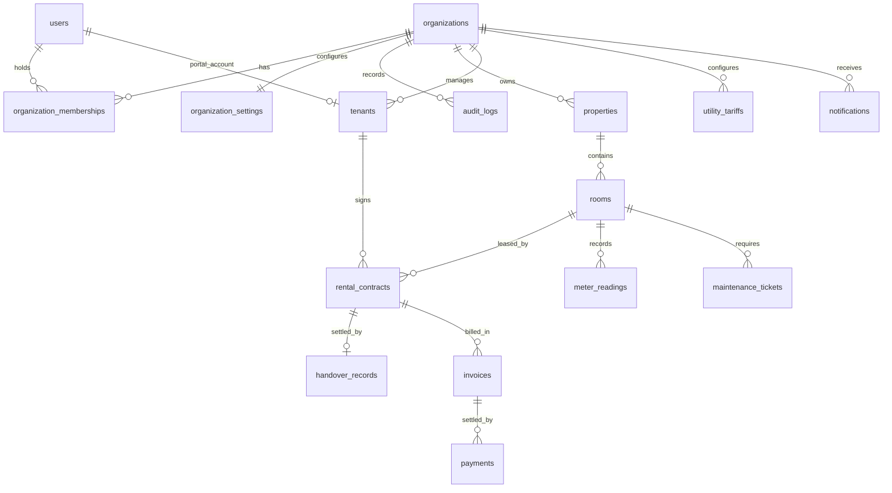

# Entity Relationship Diagram & Database Engineering

## 1. Schema Ownership & Migrations

Flyway (`backend/src/main/resources/db/migration/`) owns all DDL in PostgreSQL 16 (`spring.jpa.hibernate.ddl-auto: validate`):

- `V1__identity_property_room.sql`: `organizations`, `users`, `organization_memberships`, `properties`, `rooms`
- `V2__tenant_contract.sql`: `tenants`, `rental_contracts`
- `V3__utility_billing_payments.sql`: `utility_tariffs`, `meter_readings`, `uk_contract_org_id`, `invoices`, `payments`
- `V4__maintenance_and_handover.sql`: `rental_contracts.deposit_amount`, `handover_records`, `maintenance_tickets`, `notifications`
- `V5__rbac_audit_settings_recurring.sql`: `organization_memberships` role constraint extended (`OWNER`, `MANAGER`, `STAFF`, `TENANT`), `tenants.user_id`, `organization_settings`, `audit_logs`, and `invoices` recurring/adjustment columns (`recurring_fee_amount`, `service_fee_amount`, `discount_amount`, `adjustment_notes`) + updated `ck_invoice_amounts`.

## 2. Entity Relationship Diagram (Mermaid)

## 3. Key Integrity & Isolation Constraints

- **Composite Tenant Foreign Keys**: `rooms(organization_id, property_id)` → `properties(organization_id, id)`; `rental_contracts(organization_id, room_id)` → `rooms(organization_id, id)`; `rental_contracts(organization_id, tenant_id)` → `tenants(organization_id, id)`; `invoices(organization_id, contract_id)` → `rental_contracts(organization_id, id)`; `handover_records(organization_id, contract_id)` → `rental_contracts(organization_id, id)`; `maintenance_tickets(organization_id, room_id)` → `rooms(organization_id, id)`.
- **Uniqueness**: `uk_users_email`, `uk_room_property_code`, `uk_tariff_org_type_effective`, `uk_reading_room_utility_period`, `uk_invoice_org_contract_period`, `uk_payment_org_idempotency`, `uk_handover_contract`, `uk_tenant_user_id`.
- **Optimistic Locking**: `@Version` on `rooms`, `rental_contracts`, `invoices`, `maintenance_tickets`, and `organization_settings`.
- **Check Constraints**: Non-negative rents/deposits/prices/charges, `end_date >= start_date`, `current_reading >= previous_reading`, regex `YYYY-MM` periods, `total_amount = GREATEST(0, rent_amount + electricity_amount + water_amount + recurring_fee_amount + service_fee_amount - discount_amount)` (`ck_invoice_amounts`), and `deposit_deducted + deposit_refunded = deposit_held`.
